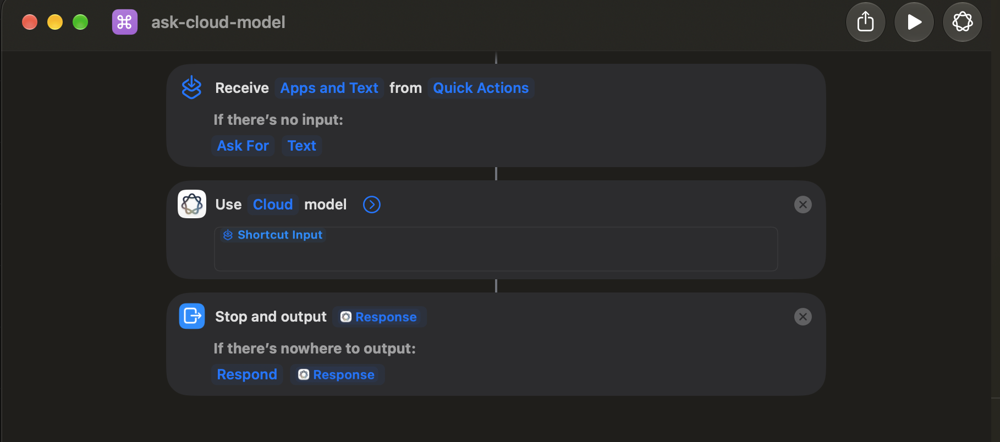

# fmc

自然言語で書いた依頼を zsh のコマンドに変換する、Mac 用のシェル関数です。
変換には Apple Foundation Models の CLI (`fm`) を使い、既定では処理がすべてオンデバイスで完結します。
設定すれば、ショートカットまたは `fm-serve` の API 経由で Apple のクラウドモデル
(PCC) を使うこともできます (依頼文が Apple のサーバーに送られます)。

```console
$ fmc "3日以内に変更された.pyファイルを検索"
✨ コマンドを生成中...

✅ 生成されたコマンド:
   find . -type f -name "*.py" -mtime -3

$ find . -type f -name "*.py" -mtime -3█    ← プロンプトに入るので、確認・編集してから Enter
```

生成されたコマンドはすぐには実行されず、zsh の入力行に置かれます。内容を確認し、必要なら編集してから Enter で実行してください。

## 特徴

- **オンデバイス (既定)**: `local` / `system` では依頼の内容を外部サービスに送りません。`cloud` や `pcc` を選ぶと Apple のサーバーを利用します。
- **fm-serve 対応**: HTTP API で `system` / `pcc` を選択でき、PCC は Terminal.app 以外のシェルからも利用できます。
- **macOS 向け**: BSD 版のコマンド (`sed -i ''`、`date -v-1d`、`stat -f` など) を使うように誘導し、Linux 専用コマンドは検証で弾きます。
- **生成後の検証と再生成**: 構文、コマンドやフラグの実在、依頼との整合性をチェックし、問題があれば理由を添えて作り直させます。
- **危険なコマンドの抑止**: `rm -rf ~` のようなコマンドはブロックします。`-y` で即実行する場合も、削除などの操作は実行前に確認します。

## 必要なもの

- `fm` コマンドが使える macOS (macOS 27 以降、Apple Intelligence が有効)
- zsh
- `fm-serve` 経由の場合は起動済みの API サーバーと `curl`・`jq` (クライアント側での `fm` 呼び出しは不要)

`fm` が使えるかは次のコマンドで確認できます。

```zsh
fm models
```

## インストール

### zsh プラグインマネージャを使う場合

`fmc.plugin.zsh` を提供しているため、各種 zsh プラグインマネージャでそのまま読み込めます。

#### Oh My Zsh
```zsh
git clone https://github.com/jhorology/fmc.git ${ZSH_CUSTOM:-~/.oh-my-zsh/custom}/plugins/fmc
```
`~/.zshrc` の `plugins=(...)` に `fmc` を追加します。
```zsh
plugins=(
  # ...
  fmc
)
```

#### Zinit
```zsh
zinit light jhorology/fmc
```

#### Antidote
`~/.zsh_plugins.txt` に追記します。
```zsh
jhorology/fmc
```

### 手動でインストールする場合

```zsh
git clone https://github.com/jhorology/fmc.git ~/fmc
echo 'source ~/fmc/fmc.plugin.zsh' >> ~/.zshrc
source ~/.zshrc
```

例文バンク (`data/examples.tsv`) と検証ルール (`data/rules.tsv`) はスクリプトと同じディレクトリまたは `data/` から自動解決されるため、リポジトリをそのままクローンして読み込むだけで使えます。

## 使い方

### 1. ショートカットから使う (おすすめ)

プロンプトで **`Ctrl+O`** を押すと、Atuin 風のポップアップ入力が開きます。

```text
╭─ ✨ fmc (自然言語からコマンド生成 / Esc: 取消)
╰─▶ 依頼: 3日以内に変更された.pyファイルを検索
```

1. 自然言語で依頼を入力して **Enter** を押します (中断したいときは **Esc** または **Ctrl+C**)。
2. 生成されたコマンドがプロンプトの入力行に直接展開されます。
3. 内容を確認・編集し、**Enter** で実行します。

> [!TIP]
> - プロンプトにすでに依頼テキストを入力した状態で `Ctrl+O` を押すと、そのテキストが初期入力として引き継がれます。
> - キーバインドを変更したい場合は後述の `FMC_KEYBIND`、アイコンを変更したい場合は `FMC_ICON` を設定してください。

### 2. コマンドから使う

```zsh
fmc "ポート8080を使っているプロセスを殺す"
fmc "git logを著者別にランキング"
fmc "list the 10 largest files in this directory"   # 英語でも可
```

| オプション | 説明 |
|---|---|
| (なし) | コマンドを生成して zsh の入力行に置く |
| `-y`, `--yes` | 生成したコマンドをすぐ実行する。削除・移動・`sudo` などの操作や、検証で問題が残った場合は実行前に確認する |
| `-p`, `--print` | コマンドだけを標準出力に出す (スクリプトやパイプ用)。検証の問題が残った場合は、警告を標準エラーに出して終了コード 2 を返す |
| `-v`, `--verbose` | 参照した例文、自動修正、検証と再生成の過程を表示する |
| `-c`, `--cloud` | クラウドのモデル (ショートカット経由) で生成する。後述の設定が必要 |
| `-l`, `--local` | オンデバイスのモデル (`fm` / `system`) で生成する。他のバックエンドや `pcc` から一時的に戻す場合にも使用可能 |
| `--backend NAME` | `local` / `cloud` / `fm-serve` を選ぶ (`fm` は `local` の別名) |
| `-m`, `--model NAME` | `local` / `fm-serve` のモデル (`system` / `pcc`) を選ぶ |
| `--base-url URL` | API の接続先 (`/v1` まで) を指定する |
| `-H`, `--history` | 生成履歴を表示する |
| `--clear-history` | 生成履歴を削除する |
| `-h`, `--help` | ヘルプを表示する |

ターミナル操作ではない入力 (「こんにちは」など) には、コマンドを生成せずにその旨を表示します。

### fm-serve 経由で利用する

#### PCC の入場券は Terminal.app

macOS 27.2 (26B123) で確認したところ、PCC を利用する `fm` は **Terminal.app から
直接起動する必要があります**。同じ Mac、同じユーザー、同じ `/usr/bin/fm` でも、
起動経路が気に入らないと次のありがたい案内で門前払いされます。

```text
Private Cloud Compute is not available in this context. Please use the Terminal app.
```

クラウド上の高度な知能を使うために、まずローカルのターミナルアプリを正しく選ぶ。
未来のコンピューティングにも、純正の玄関から入る礼儀が必要らしいです。

しかも、Terminal.app で起動さえすれば何でもよい、という大らかな話でもありません。
そこで Python を動かし、その子プロセスとして `fm serve` を起動すると PCC は利用不可。
LaunchAgent から普通に起動しても同じです。コマンドラインツールなので自由に
自動化できると思った方には、Apple らしい丁寧なサプライズが用意されています。

一方、**Terminal.app で直接起動した `fm serve` を HTTP 経由で呼ぶと PCC を利用できます**。
API の呼び出し元まで Terminal.app にする必要はありません。
玄関で純正チェックを済ませれば、あとは HTTP でどうぞ、という実に味わい深い仕様です。
以下の2通りで利用できます。

#### 手動: Terminal.app で `fm serve` を起動する

**Terminal.app を開き**、次を実行します。既存の `fm-serve` (既定ポート1976) と
競合しないよう、この例では1977を使います。

```zsh
fm models   # pcc に ✓ が付くことを確認
fm serve --host 127.0.0.1 --port 1977
```

このウィンドウはサーバー用として開いたままにします。最小化しても PCC の生成が
成功することを確認済みです。常に眺めて敬意を示す必要まではありません。
手動起動したサーバーを終了するときは、このウィンドウで Ctrl+C を押します。

**別のシェル**から、利用可否の確認と `fmc` の実行を行います。
`fmc.zsh` はあらかじめ `source` してください。

```zsh
# fm serve を直接呼ぶ場合、モデルの状態は .models に入る
curl -fsS http://127.0.0.1:1977/health \
  | jq '.models[] | select(.name == "pcc")'
# available: true を確認

fmc --backend fm-serve --base-url http://127.0.0.1:1977/v1 -m pcc \
  "今日の日付を表示"
```

`--backend fm-serve` は Chat Completions API を使う指定なので、ラッパーの
`fm-serve` プロジェクトを挟まず、Apple の `fm serve` に直接接続する場合にも使えます。

#### 常駐: `fm-serve` の LaunchAgent から Terminal.app に起動を依頼する

`fm-serve` プロジェクトのディレクトリで実行します (`mise`・`uv` が必要です)。

```zsh
cd /path/to/fm-serve   # fm-serve を配置したディレクトリに置き換える
mise install
mise exec -- uv sync
./service.sh install --terminal
./service.sh status   # PCC: 有効 を確認
```

LaunchAgent → AppleScript → Terminal.app → `fm serve` という、コマンド1つを
常駐させるための優雅な遠回りです。通常の `install` だけでは PCC は有効になりません。
`--terminal` が純正の玄関へご案内するための大切なオプションです。
初回に macOS が Terminal.app の制御許可を求めた場合は許可してください。

専用ウィンドウが1つ開き、最小化して利用できます。手で閉じると fm が終了し、
LaunchAgent の KeepAlive が起動し直すため、ウィンドウも戻ってきます。
閉じても帰ってくる親切設計なので、終了するときは `./service.sh stop` を使ってください。
`./service.sh restart` では Terminal 起動の設定を引き継ぎます。
ログイン後の GUI セッションが必要で、ログアウト中の動作は想定していません。

起動後は任意のシェルから接続します。ラッパー経由では、モデルの状態は
`/health` の **`.upstream.models`** に入ります。

```zsh
curl -fsS http://127.0.0.1:1976/health \
  | jq '.upstream.models[] | select(.name == "pcc")'
# available: true を確認
```

`/v1/models` は、利用不可でも律儀に `pcc` を陳列します。
ショーウィンドウに並んでいることと、買わせてもらえることは別の話です。
`/health` のモデル別 `available` を見るか、実際に生成して確かめてください。
サービス全体の `healthy` だけでも PCC の利用可否は判断できません。

```zsh
fmc --backend fm-serve -m pcc "今日の日付を表示"
fmc --backend fm-serve -m system -p "カレントディレクトリを表示"

# 常に fm-serve と PCC を使う場合 (~/.zshrc に設定可能)
export FMC_BACKEND=fm-serve
export FMC_MODEL=pcc
fmc "3日以内に変更された.pyファイルを検索"

# 接続先を変更 (/v1 まで指定)
fmc --base-url http://127.0.0.1:1976/v1 "今日の日付を表示"
```

`--backend`・`--base-url`・`-m` (`--model`) は環境変数より優先し、
その呼び出しにだけ適用されます。オプションは依頼文より前に指定してください。
API エラーや PCC の利用不可は標準エラーに表示し、生成を中止します。
`fm-serve` のエラー時は別のモデルや `fm` へ自動切り替えしません
(既存のショートカット経由の `cloud` には従来通りローカルへの切り替えがあります)。
生成後の検証、再生成、実行前の確認は CLI 経由と共通です。
PCC では既存のクラウド設定に合わせて例文を既定で省略します
(`FMC_CLOUD_NUM_EXAMPLES` で変更可能)。`FMC_BACKEND=fm-serve` を設定すると
`Ctrl+O` ウィジェットでも同じ接続先とモデルを使用します。

PCC / `cloud` には例文の有無に関係なく、BSD コマンドの使い方と zsh 固有の制約を
追加で指示します (`date -v`、`stat -f`、glob の引用・空一致、配列の添字、`read`、
特殊変数への代入回避など)。生成後も既知の GNU 専用オプションと bash 形式の
`read -a` / `read -p` を検証し、問題があれば理由を添えて再生成します。

### 環境変数

| 変数 | 既定値 | 説明 |
|---|---|---|
| `FMC_KEYBIND` | `^O` | ポップアップ入力を開くショートカットキー (`""` で無効化) |
| `FMC_ICON` | `✨` | プロンプトや生成状況に表示するアイコン (`🪄` や `⌘` などに変更可能) |
| `FMC_HISTORY_FILE` | `~/.fmc_history` | 履歴ファイルのパス |
| `FMC_MAX_HISTORY` | `100` | 履歴として残す最大行数 |
| `FMC_MAX_RETRIES` | `3` | 検証で問題が見つかったときの再生成回数 |
| `FMC_NUM_EXAMPLES` | `8` | few-shot としてモデルに渡す例文の最大数 |
| `FMC_EXAMPLES_FILE` | `data/examples.tsv` | 例文バンク |
| `FMC_RULES_FILE` | `data/rules.tsv` | 意味的な検証ルール |
| `FMC_BACKEND` | `local` | `local` (fm CLI) / `cloud` (ショートカット) / `fm-serve` (HTTP API)。`fm` は `local` の別名 |
| `FMC_BASE_URL` | `http://127.0.0.1:1976/v1` | API のベース URL (`/v1` まで) |
| `FMC_MODEL` | `system` | `local` / `fm-serve` のモデル (`system` / `pcc`)。`-l` は `system` に戻す |
| `FMC_TIMEOUT` | `120` | API 応答の最大待機秒数 (接続タイムアウトは5秒) |
| `FMC_SHORTCUT_NAME` | `ask-cloud-model` | `cloud` で呼ぶショートカットの名前 |
| `FMC_CLOUD_NUM_EXAMPLES` | `0` | `cloud` または `fm-serve` / `pcc` のときに渡す例文の数 |
| `FMC_STATS_FILE` | (なし) | 設定すると、生成回数・残った問題数・使ったモデルを1行ずつ追記する (評価用) |

### クラウドのモデルを使う

ショートカットアプリの「Use Model」アクションを経由して、Apple のクラウドのモデル (Private Cloud Compute) でコマンドを生成できます。オンデバイスのモデルより大幅に正確ですが (後述の評価を参照)、**依頼文が Apple のサーバーに送られます**。既定はオンデバイスのままです。

1. ショートカットアプリで `ask-cloud-model` という名前のショートカットを作り、次のようにします (英語 UI の表記)。
   - Details で **Use as Quick Action** などをオンにし、**Receive [Text] input** にする
   - **Use Model** アクションを追加し、モデルを **Cloud**、プロンプトを **Shortcut Input** だけにする
   - **Stop and Output** で **Use Model** の **Response** を返す

   
2. 動作を確認します。

   ```zsh
   print -r -- "say hi" | shortcuts run ask-cloud-model --input-path - --output-path - --output-type public.plain-text
   ```

3. `fmc -c "依頼"` で使うか、`FMC_BACKEND=cloud` を設定します。

クラウドのモデルには利用上限があります。上限の値や解除までの時間は公開されていませんが、評価で1時間ほどの間に約130回呼んだところで「You have reached the usage limit for this model.」と断られるようになりました。普段使いで上限に届くことはまず無いはずですが、評価のように続けて呼ぶときは注意してください。失敗した場合は理由を表示し、オンデバイスのモデルに切り替えて生成を続けます。

クラウドのモデルは例文を渡すとかえって精度が下がったため、既定では例文を渡しません (`FMC_CLOUD_NUM_EXAMPLES`)。検証・自動修正・再生成・危険コマンドのブロックは、オンデバイスのときと同じようにかかります。

### (コラム) ショートカットの「On-Device」モデルとの違い

ショートカットアプリの「Use Model」アクションには「On-Device」の選択肢もありますが、`fmc` ではオンデバイスの生成にショートカットを使わず、`fm` コマンドを直接呼んでいます。macOS の内部ログ (`log show`) や推論プロセスの解析、実際の生成テストで比較した結果は次のとおりです。

| 項目 | `fm` コマンド (`system`) | ショートカットの「On-Device」 |
|---|---|---|
| **ベースモデル** | `com.apple.fm.language.instruct_3b` (3B) | `com.apple.fm.language.instruct_3b` (3B) *(同一)* |
| **推論エンジン** | `TGOnDeviceInferenceProviderService` (ANE) | `TGOnDeviceInferenceProviderService` (ANE) *(同一)* |
| **ドラフト / 安全モデル** | `instruct_300m.base` / `safety` | `instruct_300m.base` / `safety` *(同一)* |
| **適用アダプタ** | `...instruct_3b.fm_api_generic` | `...instruct_3b.shortcuts_ask_afm_action_3b` |
| **内部 UseCase ID** | `FMFramework.onDevice.Public` | `com.apple.Shortcuts.AskAFMAction3B` |
| **指示 (instructions)** | `--instructions` で独立して指定可能 | プロンプト内に連結 (ショートカット用ペルソナが注入) |
| **自己認識の回答** | `...created by Apple.` | `...developed by Apple, built into Shortcuts.` |
| **指示への応答傾向** | 指示通りコマンドのみを出力しやすい | アシスタントとして聞き返しやすい (単文指示のときなど) |
| **生成速度 (1回)** | **約 0.3〜0.5 秒** | **約 0.6〜0.9 秒** (CLI・XPC のオーバーヘッドあり) |

- **基盤モデルと知識は同一**: どちらも同一の 3B モデルで動いており、例えば計算問題で全く同じ間違いを出力する (`123 * 45` に対して共に `5545` と誤答) など、内部の重みは共通です。
- **アダプタとペルソナの差**: ショートカット版はショートカット内の対話型アシスタントとしての振る舞いが組み込まれているため、短い依頼に対して「Please provide more details...」のように聞き返してしまう傾向があります。
- **結論**: オンデバイスモデルを使う場合は、オーバーヘッドがなく指示を綺麗に分離できる `fm` コマンドの直接呼び出し (`FMC_BACKEND=local`) が最も高速で安定しています。

## 仕組み

オンデバイスのモデルは小さく、単純に頼むだけでは Linux のコマンドや存在しないフラグを出しがちです。
そこで、モデルの前後に次の処理を挟んでいます。

1. **例文の検索**: 例文バンク `data/examples.tsv` (macOS で動く約140件) から、依頼に近いものを選んでモデルに渡します。日本語はカタカナ語・漢字語の単位、英語は単語単位で比べ、「削除 / 消す / remove」のような言い換えも同じ語として扱います。
2. **生成**: 短い instructions と選んだ例文を付けて、`fm respond` で1行のコマンドを生成します。`cloud` ではショートカットへ、`fm-serve` では Chat Completions API の system / user メッセージへ instructions と依頼文を渡します。`cloud` と `fm-serve` / `pcc` では例文を既定で渡しません。
3. **自動修正**: `find -o` の括弧、`sed -i ''`、`lsof -i :PORT`、`open -a "Google Chrome"` など、定型的な誤りは直接直します。
4. **検証**:
   - zsh の構文
   - コマンドが実在するか (`ip` なら `ipconfig` を使うように、などの代替案付き)
   - 使っているフラグが man ページに載っているか (macOS 標準コマンドのみ)
   - GNU 版にしかないオプションを使っていないか
   - 依頼にある数値・ファイル名・場所がコマンドに入っているか
   - macOS の知識不足による意味的な誤り (`data/rules.tsv` に1行1ルールで記述。例: 過去の日付なのに `date -v+3d`、ゴミ箱の場所)
   - 頼まれていないパッケージのインストールや、ホーム・ルートへの対象の拡大をしていないか
   - 危険なコマンドではないか
5. **再生成**: 問題があれば理由を添えて作り直させます (既定で最大3回)。解消しなかった場合は、問題点を警告として表示したうえで最も問題の少ない候補を出します。

man ページから読み取ったフラグ一覧は `~/.cache/fmc/manflags/` にキャッシュします (`XDG_CACHE_HOME` が設定されていればその下)。

## 評価

モデルを使わない回帰テストと、正解パターン付きの評価セットがあります。

```zsh
zsh tests/check.zsh                                             # 検証・自動修正の回帰テスト (数秒)
python3 -m unittest discover -s tests -v                         # API・CLI・ショートカットの接続テスト
FMC_HISTORY_FILE=/dev/null zsh tests/score.zsh fmc.zsh tests/eval.tsv
FMC_HISTORY_FILE=/dev/null zsh tests/score.zsh fmc.zsh tests/eval2.tsv
FMC_HISTORY_FILE=/dev/null zsh tests/score.zsh fmc.zsh tests/eval3.tsv
```

`tests/check.zsh` は次のことを確かめ、失敗があれば終了コード 1 を返します。

- 例文バンクの正解コマンドに対して、自動修正が何も書き換えず、検証が何も指摘しないこと
- `data/rules.tsv` の正規表現がすべて正しいこと
- 個別のテストケース (誤りを指摘できるか、正しいものを通すか、危険なコマンドをブロックするか)
- 例文バンクと評価セットに同じ問題が無いこと

`tests/test_backends.py` は Python 3 の標準ライブラリだけで動き、実モデルを呼ばずに
API のリクエスト、エラー処理、再生成、モデル選択、危険コマンドの抑止と、
既存の CLI・ショートカットの動作を確認します。

| 評価セット | 用途 | 現在 |
|---|---|---|
| `tests/eval.tsv` (40問) | 調整用 | 37/40 |
| `tests/eval2.tsv` (30問) | 調整用 | 27/30 |
| `tests/eval3.tsv` (30問) | 調整に使わない確認用 | 13/30 (クラウド: 28/30) |

クラウドのモデルで測るときは `FMC_BACKEND=cloud zsh tests/score.zsh fmc.zsh tests/eval3.tsv` のように実行します (利用上限に注意)。

各行は「リクエスト<TAB>正解コマンドの正規表現 (ERE)」の形式です。`tests/score.zsh` は点数のほかに、平均生成回数と、検証の問題が残ったまま出力された件数も表示します。問題ごとの結果や採点の限界は [docs/fmc_eval_report.md](docs/fmc_eval_report.md) にまとめています。

汎化性能を表すのは `tests/eval3.tsv` の点数だけです。`tests/eval3.tsv` の問題やそれに近い依頼を例文バンクや `data/rules.tsv` に入れると確認用として機能しなくなるので、入れないでください。eval3 の結果を見て調整したくなったら、先に新しい確認用セットを作ってください。

モデルは入力の細部 (例文の並びや空行など) で出力が変わります。instructions、例文バンク、ルールを変更したら、`tests/check.zsh` とすべての評価セットで測り直してください。

## 注意と制限

- 生成されたコマンドは、実行前に必ず内容を確認してください。検証で拾えるのは形式的な誤りだけで、意味の取り違え (「1週間前」を未来の日付にする、など) は残ります。
- macOS 固有の場所や機能 (ゴミ箱の `~/.Trash` など) は、例文に無いと正しく扱えないことがあります。
- `git` や `docker` などサブコマンドを持つツールのフラグは、man ページとの照合をしていません。
- 1回の生成には 0.5〜1 秒ほどかかり、再生成が入るとその分長くなります。

## ディレクトリ構成

```text
.
├── fmc.zsh                       # 本体 (source して使うシェル関数群)
├── fmc.plugin.zsh                # zsh プラグインエントリーポイント
├── data/
│   ├── examples.tsv              # 例文バンク (リクエスト<TAB>コマンド)
│   └── rules.tsv                 # 意味的な検証ルール
├── tests/
│   ├── check.zsh                 # モデルを使わない回帰テスト
│   ├── score.zsh                 # 採点スクリプト
│   ├── test_backends.py          # API・CLI・ショートカットの接続テスト
│   ├── eval.tsv                  # 評価セット (調整用)
│   ├── eval2.tsv                 # 評価セット (調整用)
│   └── eval3.tsv                 # 評価セット (確認用・汎化測定)
├── docs/
│   ├── fmc_eval_report.md        # 評価レポート
│   ├── review_and_fixes.md       # レビューと修正の記録
│   └── images/
│       └── ask-cloud-model.png   # ショートカット設定例の画像
├── tools/
│   └── ask-cloud-model-serve.py  # ショートカットの OpenAI 互換 API プロキシ
├── LICENSE
└── README.md
```
